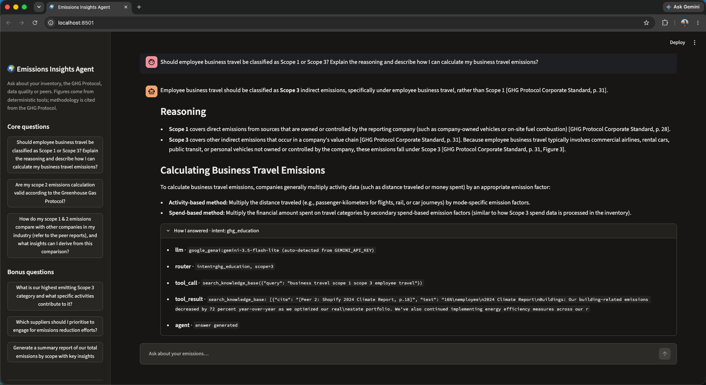
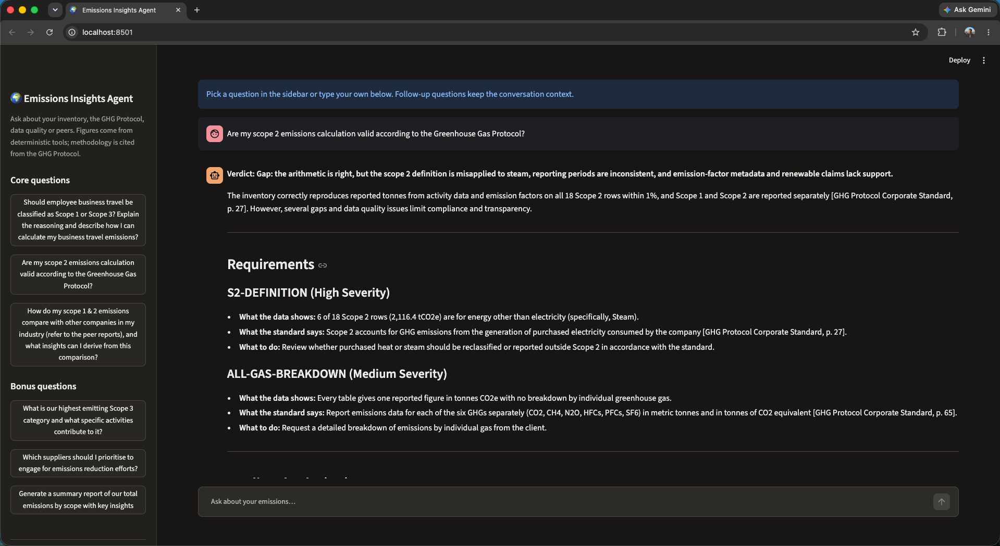
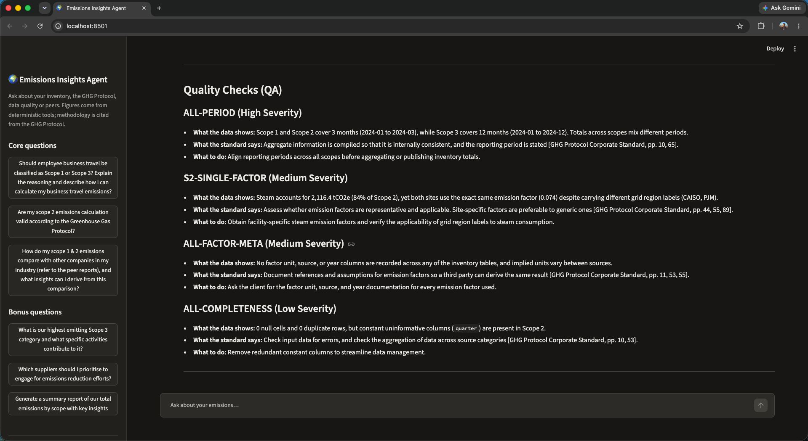
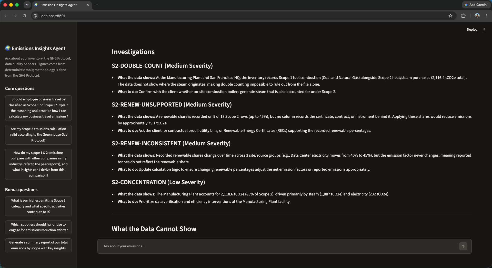
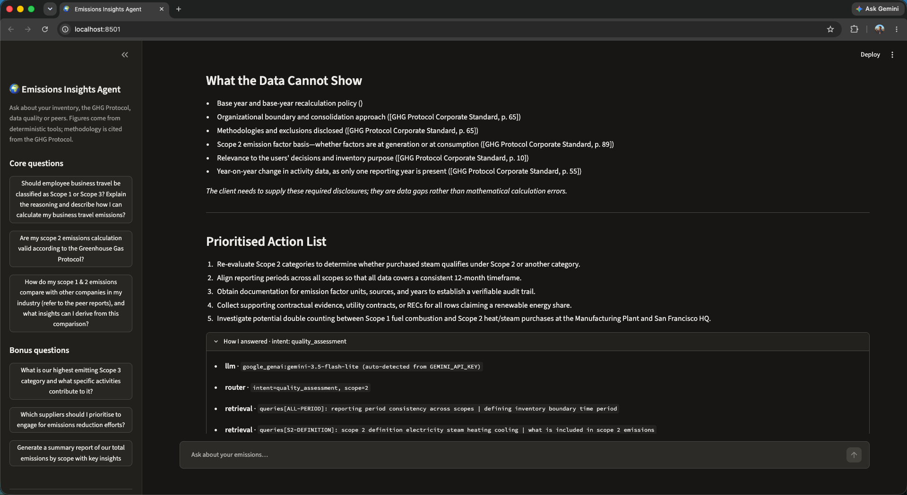
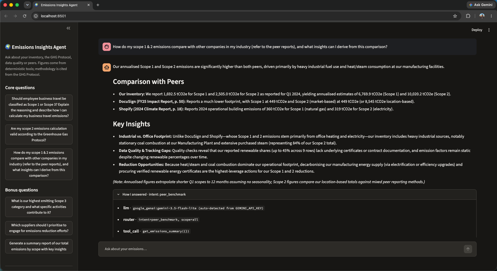
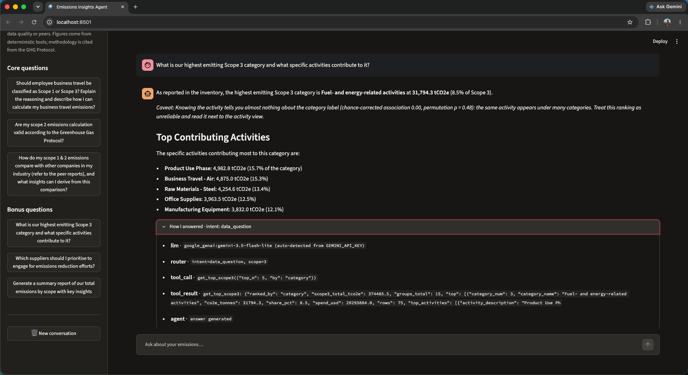
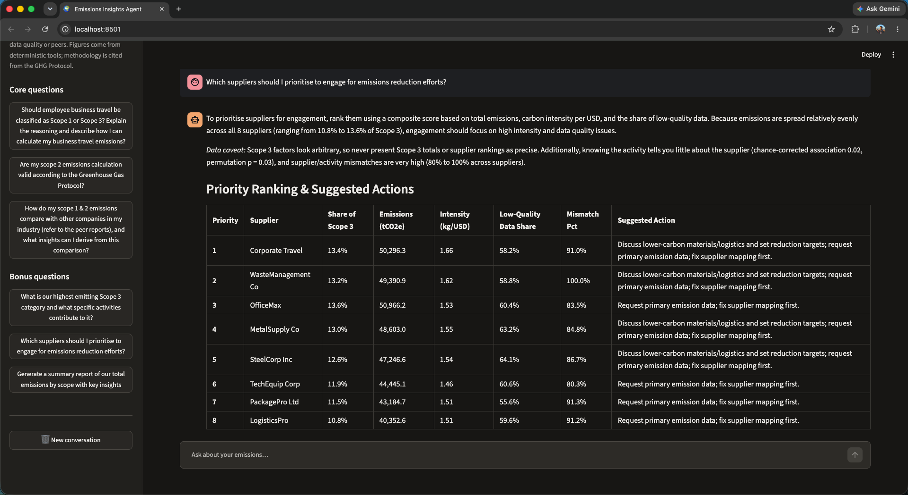
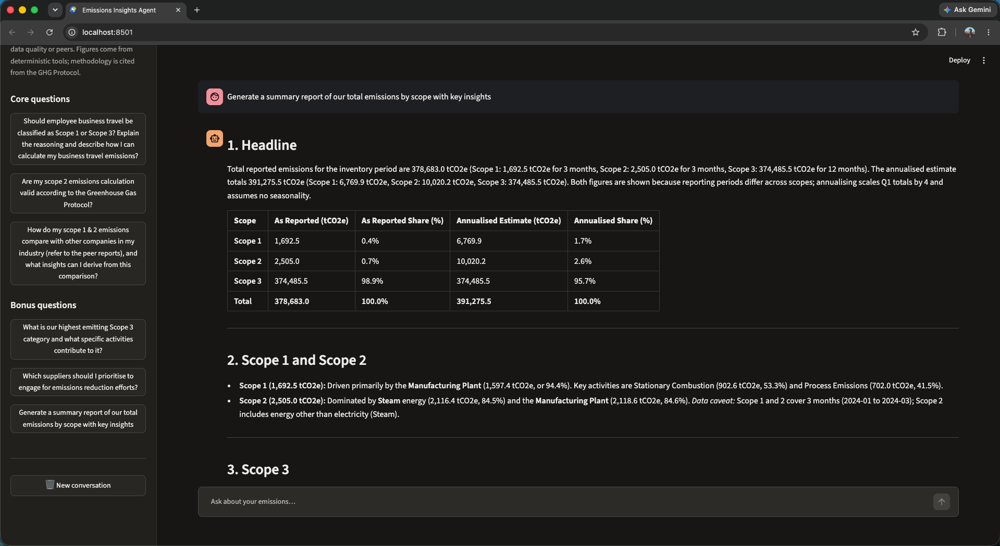
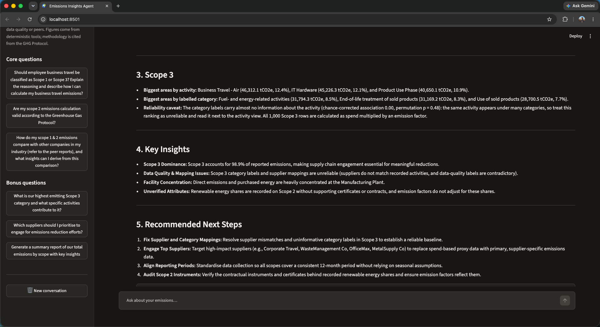

# Sample Answers

Screenshots of the Emissions Insights Agent (Streamlit app) answering the core and bonus questions from the exercise.

## Core questions

### 1. Should employee business travel be classified as Scope 1 or Scope 3? Explain the reasoning and describe how I can calculate my business travel emissions?

### 2. Are my scope 2 emissions calculation valid according to the Greenhouse Gas Protocol?

Requirements:

Quality checks:

Investigations:

Gaps and prioritised actions:

### 3. How do my scope 1 & 2 emissions compare with other companies in my industry (refer to the peer reports), and what insights can I derive from this comparison?

## Bonus questions

### 1. What is our highest emitting Scope 3 category and what specific activities contribute to it?

### 2. Which suppliers should I prioritise to engage for emissions reduction efforts?

### 3. Generate a summary report of our total emissions by scope with key insights

Headline, Scope 1 and 2:

Scope 3, key insights and next steps:

